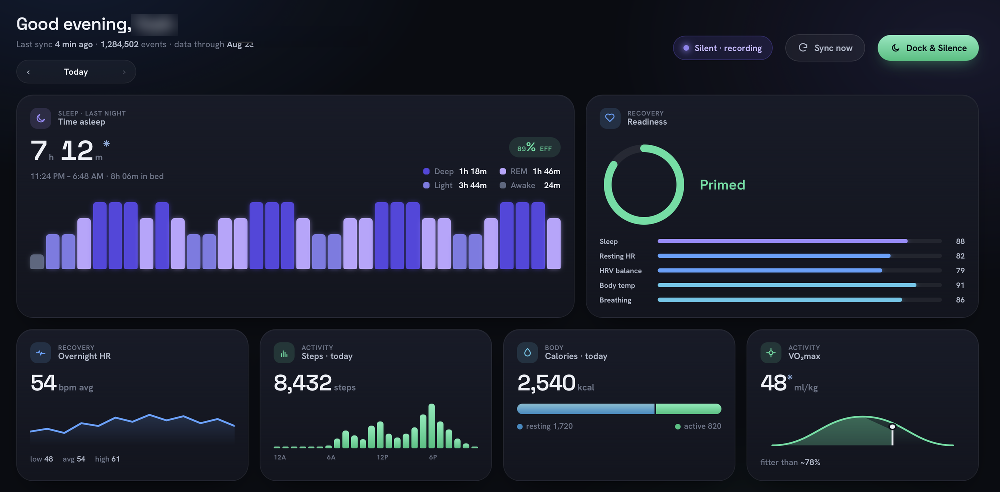

# Signet — a local-first Oura ring app, built on a reverse-engineered BLE stack



Signet reads an Oura Ring directly over Bluetooth Low Energy, stores the raw signals
on your own machine, and interprets them with open-source models. No Oura app, no
cloud, no account, no subscription. The ring stays radio-silent by default and only
wakes on the charger to sync.

This repository is a portfolio project: it shows a full stack built from scratch, from
sniffing an undocumented BLE protocol up to a polished desktop app.

## Why it is interesting

- **BLE protocol reverse-engineering.** Worked out the ring's GATT services, the binary
  sensor payloads, and control opcodes (including the flight-mode / "silence" opcode
  `0x26`), then drove them from code.
- **Local-first, privacy-by-design.** Every byte goes ring to Mac and nowhere else.
  The single biggest exposure of a normal wearable, the vendor cloud, is simply removed.
- **A real desktop app.** `Signet` is a Tauri 2 app: a Rust core with a React and
  TypeScript front end, packaged as a native macOS `.app`.
- **Honest metrics.** Every number is tagged `real`, `preview`, or `pending`, and any
  value that needs a personal baseline is flagged until it has been earned (about a
  week of nights). Nothing shows a fake number.
- **Adapting to a new domain.** Picked up Rust, Tauri, and BLE sniffing to ship this.

## Architecture

```
Ring --BLE--> acquisition (open_oura) --> local SQLite (raw events)
                                              |
                                    Python interpreters
                     (SleepECG, Cole-Kripke, NeuroKit2, Jackson VO2max, Schofield BMR)
                                              |
                                        metrics.db (derived)
                                              |
                                   Signet app (Tauri: Rust + React)
```

- **Radio-silent by default.** The ring is put in flight mode (`0x26`); its radio only
  wakes while docked, at sync time.
- **One local database is the source of truth.** Any number of visual layers sit on top.
- **Interpreter outputs are documented equivalents,** not vendor-identical numbers.

## The app (`app/`)

Tauri 2, Rust core in `app/src-tauri`, React + TypeScript + Vite front end in `app/src`.

- **Live ring control:** Sync now (drain history), battery, and "Dock & Silence"
  (flight mode, hardware-verified silent).
- **Sleep** hero card: a per-cell hypnogram with stage and clock tooltips.
- **VO2max** with an ACSM fitness-zone bar and a trend that fills in as values accrue.
- **Calories** split into resting (Schofield BMR) and active (from MET).
- **Movement / MET** intraday sparkline, **steps**, **HR / RHR / HRV**, skin temp, SpO2.
- **Personal baselines:** once enough nights accrue, a DIY readiness score and
  deviation-from-baseline light up. Before then, values carry a `*`.

## Interpreters (`interpret/`)

Transparent, open-source signal processing over the raw ring events:

- `sleep_stage.py` — hypnogram from overnight inter-beat intervals via **SleepECG**
  (GRU classifiers pretrained on MESA), plus a **Cole-Kripke** actigraphy cross-check.
- `sleep_features.py` — the Cole-Kripke / feature layer.
- `vo2max.py` — a Jackson non-exercise estimate plus a walk-based reading.
- `run_ehr.py` — daytime heart rate decoded from the ring's `ehr_trace` stream.
- `build_daily.py` — the per-day metric history the baselines trend over.
- `oura_sleep_io.py`, `ring_clock.py`, `introspect.py` — IO, clock, and DB helpers.

## Sync orchestration (`sync/`)

- `flight_mode.py` — arm / disarm the radio (`0x26`).
- `dock_watch.py` — auto-sync when the ring is placed on its charger.
- `pipeline.sh` — the on-dock pipeline: drain to SQLite, then interpret. Includes the
  hard-won handling of a real on-hardware quirk, where the BLE client commits the sync
  and then hangs on disconnect, so the pipeline watches for the "Done" marker and
  resumes cleanly from a saved cursor across dropped links.

## Repository layout

```
app/          Signet desktop app (Tauri 2: Rust + React/TS)
interpret/    open-source interpreters over the raw ring events
sync/         BLE sync + flight-mode orchestration
mockups/      early interactive HTML mockups of the UI
db/           the derived-metrics SQLite schema
SPEC.md       requirements, architecture, data model, roadmap
DESKTOP_APP_SPEC.md   the app's UX + security design
LABELING.md   self-labeling protocol for building a personal training set
```

## Build

```bash
cd app
npm install
npm run tauri dev     # hot-reload dev
npm run tauri build   # release .app + .dmg
```

The acquisition layer (the `open_oura` BLE toolkit) and a physical Oura ring are needed
to sync live. This repo is a showcase of the app, the interpreters, and the protocol
work rather than a turnkey install.

## Privacy and security posture

- **Local only.** Data goes ring to your Mac and never touches any cloud.
- **Key-gated.** The ring only obeys a controller that holds its pairing key, so a
  random device cannot connect, read, or command it.
- **Short-range BLE.** A passive sniffer would need special hardware within a few
  metres; only advertising and MAC are ever in the clear, not your metrics.
- **Flight mode (`0x26`)** turns the radio fully off: no RF, no discoverability, no sync
  until you dock again.

## Credits

- [`open_oura`](https://github.com/Th0rgal/open_oura) by Thomas Marchand — the
  reverse-engineered local BLE toolkit this builds on for acquisition.
- [NeuroKit2](https://github.com/neuropsychology/NeuroKit) — HRV and respiration.
- [SleepECG](https://github.com/cbrnr/sleepecg) — the pretrained sleep-staging models.
- The `ringverse` protocol notes for the BLE opcode reference.

## Disclaimer

Independent interoperability and personal-data-ownership research. Not affiliated with,
endorsed by, or connected to Oura or Oura Health Oy. "Oura" is a trademark of its owner.
This project reads a ring the author owns and interprets its raw signals with
open-source methods. It does **not** include, redistribute, or explain how to obtain
any of Oura's proprietary models, model-decryption keys, account credentials, or any
method of circumventing Oura's paywall or account system.

## License

MIT — see [LICENSE](LICENSE). Applies to the original code in this repository; upstream
components keep their own licenses.
